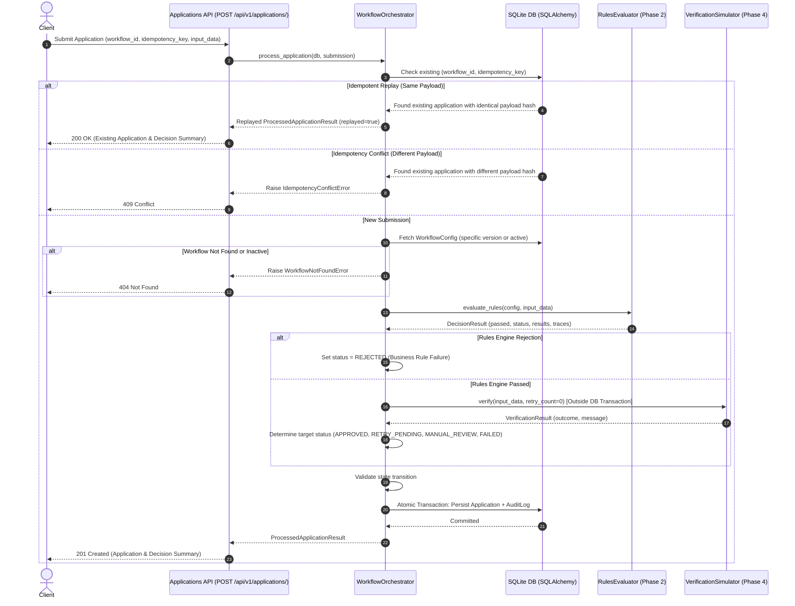

# FlowGuard

> **A Configurable Workflow Decision Platform**

FlowGuard is a modular, extensible, and verified MVP decision platform designed to execute configurable business workflows, rule evaluations, and decision pipelines without hardcoded logic. Built as a self-contained prototype on FastAPI, SQLAlchemy 2.0, and SQLite, FlowGuard demonstrates deterministic rule evaluation, stateful workflow orchestration, bounded retry resilience, and transactional audit logging without external message brokers or distributed queue infrastructure.

---

## 🛠 Tech Stack

- **Language:** Python 3.12 (Python 3.10+ supported)
- **Web Framework:** [FastAPI](https://fastapi.tiangolo.com/)
- **ASGI Server:** [Uvicorn](https://www.uvicorn.org/)
- **Database ORM:** [SQLAlchemy](https://www.sqlalchemy.org/) 2.0+
- **Database Engine:** SQLite (embedded, foreign keys enforced via `PRAGMA foreign_keys=ON`)
- **Data Validation & Settings:** [Pydantic](https://docs.pydantic.dev/) v2 & [Pydantic-Settings](https://docs.pydantic.dev/latest/concepts/pydantic_settings/)
- **Testing:** [Pytest](https://docs.pytest.org/) & [HTTPX](https://www.python-httpx.org/)

---

## 📁 Project Structure

```text
FlowGuard/
├── app/
│   ├── __init__.py                     # Application package definition
│   ├── main.py                         # FastAPI application factory & route registration
│   ├── api/                            # API routing layer
│   │   ├── __init__.py
│   │   └── v1/
│   │       ├── __init__.py
│   │       ├── router.py               # v1 API router aggregator (health + applications)
│   │       └── endpoints/              # Route handlers
│   │           ├── __init__.py
│   │           ├── applications.py     # POST /api/v1/applications/ & /{id}/retry (Phase 3 & 4)
│   │           └── health.py           # Health check endpoint (GET /health)
│   ├── core/                           # Core system configurations
│   │   ├── __init__.py
│   │   ├── config.py                   # App settings (Pydantic BaseSettings, MAX_RETRIES)
│   │   └── database.py                 # SQLite connection, FK PRAGMA, session factory
│   ├── models/                         # SQLAlchemy 2.0 ORM models (Phase 1)
│   │   ├── __init__.py
│   │   ├── application.py              # Application decision entity (retry_count, status)
│   │   ├── audit_log.py                # State transition & decision audit trail
│   │   └── workflow_config.py          # Versioned immutable workflow configuration
│   ├── orchestration/                  # Workflow Orchestration Layer (Phase 3 & 4)
│   │   ├── __init__.py                 # Orchestration package exports
│   │   ├── exceptions.py               # Orchestration & retry error hierarchy
│   │   ├── orchestrator.py             # WorkflowOrchestrator implementation
│   │   └── state.py                    # ApplicationStatus & state transition validation
│   ├── rules/                          # Standalone Rules Engine (Phase 2)
│   │   ├── __init__.py                 # Rules engine public API exports
│   │   ├── decision.py                 # DecisionResult & RuleEvaluationResult schemas
│   │   ├── evaluator.py                # Deterministic RulesEvaluator & trace generator
│   │   ├── exceptions.py               # RulesEngineError hierarchy
│   │   ├── operators.py                # Safe whitelisted operator registry & functions
│   │   └── schemas.py                  # Pydantic schemas for Mandatory, Threshold, Conditional, Group rules
│   ├── schemas/                        # System-wide Pydantic schemas
│   │   ├── __init__.py
│   │   ├── application.py              # Application submission & response schemas (Phase 3 & 4)
│   │   └── health.py                   # Health check payload schema
│   ├── services/                       # Service layer & atomic persistence (Phase 1)
│   │   ├── __init__.py
│   │   ├── application_service.py      # Atomic application & audit updates
│   │   └── workflow_config_service.py  # Configuration versioning and immutability
│   └── verification/                   # External Verification Simulation (Phase 4)
│       ├── __init__.py                 # Verification package exports
│       └── simulator.py                # Deterministic ExternalVerificationSimulator
├── tests/                              # Automated test suite (92 passing tests)
│   ├── __init__.py
│   ├── conftest.py                     # Pytest fixtures (TestClient, isolated DB sessions)
│   ├── test_application_api.py         # API submission, validation, & HTTP status tests (Phase 3)
│   ├── test_atomic_persistence.py      # Atomic commit & rollback tests (Phase 3)
│   ├── test_database.py                # Database initialization & FK PRAGMA tests (Phase 1)
│   ├── test_decision_traces.py         # Decision trace structure, metadata, & privacy tests (Phase 2)
│   ├── test_health.py                  # Health and documentation tests (Phase 0)
│   ├── test_idempotency.py             # Idempotency replay & conflict tests (Phase 3)
│   ├── test_models.py                  # Model insertion, relationships, FKs, constraints (Phase 1)
│   ├── test_operators.py               # Safe operator whitelist & operand type tests (Phase 2)
│   ├── test_resilience_and_retries.py  # Resilience, retries, simulator & idempotency tests (Phase 4)
│   ├── test_rule_evaluator.py          # Rules evaluation engine tests (Phase 2)
│   ├── test_rule_schemas.py            # Pydantic schema validation & bounds tests (Phase 2)
│   ├── test_transactions.py            # Transaction management tests (Phase 1)
│   └── test_workflow_orchestration.py  # Orchestrator lifecycle & state transition tests (Phase 3)
├── .gitignore                          # Git ignore file for Python, SQLite, caches
├── README.md                           # Project documentation
├── requirements.txt                    # Production and development dependencies
└── run.py                              # Clean application entry point script
```

---

## 🔄 Workflow Orchestration & Processing API (Phase 3)

The orchestration layer bridges persisted workflow configurations, the rules engine, simulated external verification, and application state transitions into an atomic execution pipeline.



### Application State Machine

- **States:** `PENDING`, `APPROVED`, `REJECTED`, `RETRY_PENDING`, `MANUAL_REVIEW`, `FAILED`.
- **Allowed Transitions:**
  - `PENDING` → `APPROVED` (Rules passed and external verification succeeded)
  - `PENDING` → `RETRY_PENDING` (Rules passed, transient verification failure, `max_retries > 0`)
  - `PENDING` → `MANUAL_REVIEW` (Rules passed, transient verification failure, `max_retries == 0`)
  - `PENDING` → `REJECTED` (Rules evaluation failed; permanent business rule rejection)
  - `PENDING` → `FAILED` (External verification returned persistent failure)
  - `RETRY_PENDING` → `APPROVED` (Retry attempt succeeded)
  - `RETRY_PENDING` → `RETRY_PENDING` (Retry encountered temporary failure, retry attempts remaining)
  - `RETRY_PENDING` → `MANUAL_REVIEW` (Retry encountered temporary failure, maximum retries exhausted)
  - `RETRY_PENDING` → `FAILED` (Retry encountered persistent failure)
- **Terminal States:** `APPROVED`, `REJECTED`, `MANUAL_REVIEW`, and `FAILED` are terminal for automated processing. Calling the retry endpoint on these states returns HTTP `400 Bad Request` (`IneligibleRetryError`).

### Idempotency & Concurrency Guarantees

- **Identical Submission Replay:** Submitting the same `idempotency_key` and `workflow_id` with an identical payload hash returns HTTP `200 OK` with the existing application record. The decision summary is reconstructed from the original audit log (`metadata.replayed: true`), avoiding redundant workflow execution and avoiding duplicate audit logs.
- **Payload Collision Conflict:** Reusing the same `idempotency_key` for the same `workflow_id` with a different payload returns HTTP `409 Conflict`.
- **Database-Level Race Protection:** Concurrent submissions with the same key are protected at the database tier by SQLite's `UniqueConstraint("workflow_id", "idempotency_key")`. If near-simultaneous requests race, one transaction commits and the racing insert raises an `IntegrityError`; the orchestrator catches this, rolls back the conflicting transaction, and returns the committed record as an idempotent replay (or returns `409 Conflict` if payloads differ).
- **MVP Scope & Limitations:** FlowGuard is designed as a single-node, embedded SQLite MVP. It does not implement distributed consensus locks (e.g., Redis Redlock) or message deduplication queues. Because external verification simulation runs before the database transaction is opened, concurrent in-flight submissions with identical keys may both execute the simulator before one is serialized and rolled back at commit time.

### API Endpoints

| Endpoint | Method | Status Codes | Description |
| :--- | :--- | :--- | :--- |
| `/api/v1/applications/` | `POST` | `201 Created`, `200 OK`, `400`, `404`, `409`, `422`, `500` | Process application against workflow rules & external verification |
| `/api/v1/applications/{application_id}/retry` | `POST` | `200 OK`, `400 Bad Request`, `404 Not Found` | Retry an eligible application in `RETRY_PENDING` status |
| `/health` | `GET` | `200 OK` | Platform health status |
| `/api/v1/health` | `GET` | `200 OK` | Platform health status (v1 prefixed) |
| `/docs` | `GET` | `200 OK` | Interactive OpenAPI / Swagger UI |

#### Sample Application Submission Request (`POST /api/v1/applications/`):

```json
{
  "workflow_id": "loan_approval",
  "idempotency_key": "app-idemp-001",
  "input_data": {
    "applicant_name": "Eleanor Vance",
    "applicant_age": 29,
    "annual_income": 450000
  }
}
```

#### Sample Approved Response (`201 Created`):

```json
{
  "id": 1,
  "request_id": "req-4d6102c93054",
  "workflow_id": "loan_approval",
  "workflow_config_id": 1,
  "workflow_version": 1,
  "idempotency_key": "app-idemp-001",
  "status": "APPROVED",
  "retry_count": 0,
  "verification_outcome": "SUCCESS",
  "failure_reason": null,
  "decision": {
    "status": "approved",
    "passed": true,
    "total_rules": 2,
    "passed_rules": 2,
    "failed_rules": 0,
    "results": [
      {
        "rule_id": "REQ_NAME",
        "category": "mandatory",
        "passed": true,
        "reason": "Mandatory field 'applicant_name' is present and non-empty"
      },
      {
        "rule_id": "MIN_INCOME",
        "category": "threshold",
        "passed": true,
        "reason": "Field 'annual_income' satisfies the threshold requirement (gte 300000)"
      }
    ],
    "metadata": {
      "mandatory_failed": false,
      "config_version": 1
    }
  },
  "created_at": "2026-11-13T10:24:26.232939Z",
  "updated_at": "2026-11-13T10:24:26.232939Z"
}
```

---

## 🛡 Resilience, Retries & External Verification Simulator (Phase 4)

FlowGuard implements failure-resistant workflow execution with bounded retries, simulated external verification, and duplicate-execution protection.

### 1. External Verification Simulator
FlowGuard decouples internal business rule evaluation from external third-party dependencies (such as KYC, credit bureaus, identity checks, or fraud detection APIs). In this MVP, no real network calls are made. External dependencies are modeled deterministically using the built-in `ExternalVerificationSimulator`.

Key Simulator Characteristics:
- **Simulated Environment:** No external network sockets, credentials, or live third-party services are accessed.
- **Transaction Isolation:** Verification executes **strictly outside database transactions** to guarantee that simulated latency does not hold SQLite database locks open.
- **Configurable via Directives:** For deterministic testing and demonstration, simulation behaviors can be controlled via input fields in the application payload:
  - **Default (no directive):** Returns `SUCCESS` (`outcome: "SUCCESS"`).
  - `simulated_verification: "SUCCESS"`: Explicit success.
  - `simulated_verification: "TEMPORARY_FAILURE"`: Simulates a transient network/service timeout. Moves application to `RETRY_PENDING`.
  - `simulated_verification: "PERSISTENT_FAILURE"`: Simulates a permanent fraud or identity verification rejection. Moves application directly to `FAILED` (ineligible for retries).
  - `simulated_verification: "TEMPORARY_ONCE"`: Fails on initial submission (`retry_count == 0`), but recovers and succeeds on retry (`retry_count >= 1`).
  - `fail_until_retry: N`: Configures the simulator to fail until `retry_count >= N`, then recover to `SUCCESS`.

### 2. Bounded Retries & State Progression

- **Configuration Precedence:**
  - **Global System Default:** Configured via `settings.max_retries` (environment variable `MAX_RETRIES`, defaults to `3`).
  - **Per-Workflow Override:** Can be customized per workflow configuration version by specifying `"max_retries": <int>` at the top level of `config_data` in `WorkflowConfig` (e.g., `"max_retries": 5` or `"max_retries": 0`).
  - **Precedence Rule:** If `"max_retries"` is specified in the workflow's `config_data`, it takes precedence over the global setting; otherwise, `settings.max_retries` is used.
- **Eligibility Checking:** Only applications currently in `RETRY_PENDING` status are eligible for retry.
- **Retry Exhaustion:** Each retry increment is tracked on `application.retry_count`. When `retry_count >= max_retries`, the application transitions to `MANUAL_REVIEW` (`RETRY_EXHAUSTED_MANUAL_REVIEW`).
- **Immediate Manual Review (`max_retries == 0`):** If a workflow config specifies `max_retries: 0`, any transient verification failure moves the application directly from `PENDING` to `MANUAL_REVIEW` on initial submission without entering `RETRY_PENDING`.
- **Permanent Business Failures:** Applications failing rules engine evaluation transition to `REJECTED`. Business rule rejections are permanent and cannot be retried.
- **Terminal States:** Applications in `APPROVED`, `REJECTED`, `FAILED`, or `MANUAL_REVIEW` cannot be retried. Attempts return HTTP `400 Bad Request`.

### 3. Retry API (`POST /api/v1/applications/{application_id}/retry`)

#### Sample Retry Request:
```http
POST /api/v1/applications/1/retry
Content-Type: application/json
```

#### Sample Successful Retry Response (`200 OK`):
```json
{
  "id": 1,
  "request_id": "req-4d6102c93054",
  "workflow_id": "loan_approval",
  "workflow_config_id": 1,
  "workflow_version": 1,
  "idempotency_key": "app-idemp-001",
  "status": "APPROVED",
  "retry_count": 1,
  "verification_outcome": "SUCCESS",
  "failure_reason": null,
  "decision": {
    "status": "APPROVED",
    "passed": true,
    "total_rules": 2,
    "passed_rules": 2,
    "failed_rules": 0,
    "results": [],
    "metadata": {
      "replayed": true,
      "workflow_version": 1
    }
  },
  "created_at": "2026-11-13T10:24:26.232939Z",
  "updated_at": "2026-11-13T10:25:12.871021Z"
}
```

#### Sample Exhausted Retries Response (`200 OK`):
```json
{
  "id": 2,
  "request_id": "req-8b92ef104c81",
  "workflow_id": "loan_approval",
  "workflow_config_id": 1,
  "workflow_version": 1,
  "idempotency_key": "app-idemp-002",
  "status": "MANUAL_REVIEW",
  "retry_count": 3,
  "verification_outcome": "TEMPORARY_FAILURE",
  "failure_reason": "Max retries exhausted (3/3): Temporary verification failure: external dependency unavailable or timed out.",
  "decision": {
    "status": "MANUAL_REVIEW",
    "passed": true,
    "total_rules": 2,
    "passed_rules": 2,
    "failed_rules": 0,
    "results": [],
    "metadata": {
      "replayed": true,
      "workflow_version": 1
    }
  },
  "created_at": "2026-11-13T10:24:26.232939Z",
  "updated_at": "2026-11-13T10:26:45.391219Z"
}
```

> [!NOTE]
> **Understanding Response Metadata (`replayed: true`):**
> On fresh evaluation during initial submission, `decision.metadata` contains live evaluation details (`mandatory_failed`, `config_version`) and `results` lists all evaluated rules.
> When a response is reconstructed (during an idempotent replay of `POST /api/v1/applications/` or during a retry via `POST /api/v1/applications/{id}/retry`), the decision summary is reconstructed from the initial audit log rather than re-running the rules engine. In these reconstructed summaries, `metadata.replayed` is set to `true`, and `results` is an empty list (`[]`) because the historical decision summary is replayed.

### 4. Audit Trail Events & Persistence Scope

Every lifecycle transition appends an audit entry with structured details:
- `APPLICATION_APPROVED`: Application passed rules and external verification on initial submission.
- `APPLICATION_REJECTED`: Application failed business rules evaluation (terminal).
- `APPLICATION_RETRY_PENDING`: Application initially placed in retry queue due to transient verification failure.
- `APPLICATION_FAILED`: Application failed due to persistent verification rejection.
- `TRANSITIONED_TO_MANUAL_REVIEW`: Application transitioned to manual review on initial submission (`max_retries == 0`).
- `RETRY_FAILED_TEMPORARY`: Retry failed due to transient error, remaining retry attempts exist.
- `RETRY_SUCCEEDED`: Retry succeeded, application status transitioned to `APPROVED`.
- `RETRY_EXHAUSTED_MANUAL_REVIEW`: Maximum retry limit reached on retry attempt, application moved to `MANUAL_REVIEW`.
- `RETRY_FAILED_PERSISTENT`: Retry encountered persistent dependency rejection, application moved to `FAILED`.

**Audit Trail Immutability Scope:**
Audit log immutability is maintained **at the application and service layer**: the platform only performs `INSERT` operations on `AuditLog` and provides no update or delete routes. The underlying SQLite database does not enforce hardware write-once media or database-level update triggers.

---

## ⚡ Rules Engine (Phase 2)

FlowGuard includes a standalone, deterministic, and secure rules engine that evaluates incoming application payloads against versioned workflow configurations without external code execution.

### Supported Rule Categories:
1. **Mandatory Field Rules (`mandatory`):** Verifies required fields exist, are not null, and (optionally) non-empty strings.
2. **Threshold Rules (`threshold`):** Performs numeric comparisons (`gt`, `gte`, `lt`, `lte`, `eq`, `ne`) against configured boundaries.
3. **Conditional Rules (`conditional`):** Evaluates logical implications (`when` antecedent → `then` assertion).
4. **Group Rules (`group`):** Evaluates composite conditions using `AND` and `OR` combinators with bounded recursion depth (max depth ≤ 3).

### Safe Operator Whitelist:
Only predefined, registered operators are allowed: `eq`, `ne`, `gt`, `gte`, `lt`, `lte`, `in`, `not_in`, `exists`, `not_exists`.

---

## 🗄 Database Models & Relationships (Phase 1)

1. **`WorkflowConfig` (`workflow_configs`):** Versioned, immutable workflow rulesets. Uniqueness is enforced on `(workflow_id, version)`. Immutability of historical versions is enforced by application-level validation prohibiting updates to existing versions.
2. **`Application` (`applications`):** Application requests, input payloads, idempotency keys, payload hashes, retry counts, and statuses. Uniqueness is enforced on `(workflow_id, idempotency_key)`.
3. **`AuditLog` (`audit_logs`):** Append-only audit trail capturing every state transition and evaluation outcome. Linked to `Application` via foreign key with cascade deletion on application deletion.

---

## 🏃 Running the Application

```bash
python run.py
```

Server URL: `http://127.0.0.1:8000`  
Interactive Docs: `http://127.0.0.1:8000/docs`

---

## 🧪 Running Tests

To run the full automated test suite (92 tests across Phases 0, 1, 2, 3, and 4):

```bash
pytest -v
```

### Test Suite Distribution (92 Passed)

- **Phase 0 (Foundation & Health):** 4 tests in `tests/test_health.py`
- **Phase 1 (Database, Models & Transactions):** 16 tests in `tests/test_database.py`, `tests/test_models.py`, `tests/test_transactions.py`
- **Phase 2 (Configurable Rules Engine):** 36 tests in `tests/test_operators.py`, `tests/test_rule_schemas.py`, `tests/test_rule_evaluator.py`, `tests/test_decision_traces.py`
- **Phase 3 (Workflow Orchestration & API):** 19 tests in `tests/test_application_api.py`, `tests/test_workflow_orchestration.py`, `tests/test_atomic_persistence.py`, `tests/test_idempotency.py`
- **Phase 4 (Resilience, Retries & Simulator):** 17 tests in `tests/test_resilience_and_retries.py`

---

## 📌 Phase Roadmap

- [x] **Phase 0:** Foundation (FastAPI setup, `/health`, `/docs`, configuration).
- [x] **Phase 1:** Database & Persistence (SQLAlchemy 2.0 models, SQLite foreign keys, transactions, session management).
- [x] **Phase 2:** Configurable Rules Engine (Pydantic v2 schemas, operator whitelist, decision traces, determinism).
- [x] **Phase 3:** Workflow Orchestration & Application Processing API (`POST /api/v1/applications/`, state management, idempotency replay/conflict, atomic persistence).
- [x] **Phase 4:** Resilience, Retries & Idempotency (external verification simulator, bounded retries, state machine expansion to `RETRY_PENDING` / `MANUAL_REVIEW`, retry API, duplicate protection) — **92 passing automated tests**.
