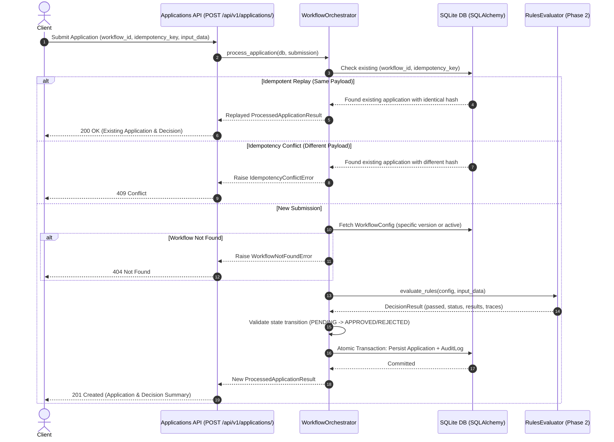

# FlowGuard

> **A Configurable Workflow Decision Platform**

FlowGuard is a modular and extensible decision platform designed to execute configurable business workflows, rule evaluations, and decision pipelines without hardcoded logic.

---

## 🛠 Tech Stack

- **Language:** Python 3.12 (Python 3.10+ supported)
- **Web Framework:** [FastAPI](https://fastapi.tiangolo.com/)
- **ASGI Server:** [Uvicorn](https://www.uvicorn.org/)
- **Database ORM:** [SQLAlchemy](https://www.sqlalchemy.org/) 2.0+
- **Database Engine:** SQLite (embedded, foreign keys enforced)
- **Data Validation & Settings:** [Pydantic](https://docs.pydantic.dev/) v2 & [Pydantic-Settings](https://docs.pydantic.dev/latest/concepts/pydantic_settings/)
- **Testing:** [Pytest](https://docs.pytest.org/) & [HTTPX](https://www.python-httpx.org/)

---

## 📁 Project Structure

```text
FlowGuard/
├── app/
│   ├── __init__.py                     # Application package definition
│   ├── main.py                         # FastAPI application factory & route registration
│   ├── api/                            # API routing layer
│   │   ├── __init__.py
│   │   └── v1/
│   │       ├── __init__.py
│   │       ├── router.py               # v1 API router aggregator (health + applications)
│   │       └── endpoints/              # Route handlers
│   │           ├── __init__.py
│   │           ├── applications.py     # POST /api/v1/applications/ & /{id}/retry (Phase 3 & 4)
│   │           └── health.py           # Health check endpoint (GET /health)
│   ├── core/                           # Core system configurations
│   │   ├── __init__.py
│   │   ├── config.py                   # App settings (Pydantic BaseSettings)
│   │   └── database.py                 # SQLite connection, FK PRAGMA, session factory
│   ├── models/                         # SQLAlchemy 2.0 ORM models (Phase 1)
│   │   ├── __init__.py
│   │   ├── application.py              # Application decision entity
│   │   ├── audit_log.py                # State transition & decision audit trail
│   │   └── workflow_config.py          # Versioned immutable workflow configuration
│   ├── orchestration/                  # Workflow Orchestration Layer (Phase 3)
│   │   ├── __init__.py                 # Orchestration package exports
│   │   ├── exceptions.py               # Orchestration error hierarchy
│   │   ├── orchestrator.py             # WorkflowOrchestrator implementation
│   │   └── state.py                    # ApplicationStatus & state transition validation
│   ├── rules/                          # Standalone Rules Engine (Phase 2)
│   │   ├── __init__.py                 # Rules engine public API exports
│   │   ├── decision.py                 # DecisionResult & RuleEvaluationResult schemas
│   │   ├── evaluator.py                # Deterministic RulesEvaluator & trace generator
│   │   ├── exceptions.py               # RulesEngineError hierarchy
│   │   ├── operators.py                # Safe whitelisted operator registry & functions
│   │   └── schemas.py                  # Pydantic schemas for Mandatory, Threshold, Conditional, Group rules
│   ├── schemas/                        # System-wide Pydantic schemas
│   │   ├── __init__.py
│   │   ├── application.py              # Application submission & response schemas (Phase 3 & 4)
│   │   └── health.py                   # Health check payload schema
│   ├── services/                       # Service layer & atomic persistence (Phase 1)
│   │   ├── __init__.py
│   │   ├── application_service.py      # Atomic application & audit updates
│   │   └── workflow_config_service.py  # Configuration versioning and immutability
│   └── verification/                   # External Verification Simulation (Phase 4)
│       ├── __init__.py                 # Verification package exports
│       └── simulator.py                # Deterministic ExternalVerificationSimulator
├── tests/                              # Automated test suite
│   ├── __init__.py
│   ├── conftest.py                     # Pytest fixtures (TestClient, isolated DB sessions)
│   ├── test_application_api.py         # API submission, validation, & HTTP status tests (Phase 3)
│   ├── test_atomic_persistence.py      # Atomic commit & rollback tests (Phase 3)
│   ├── test_database.py                # Database initialization & FK PRAGMA tests (Phase 1)
│   ├── test_decision_traces.py         # Decision trace structure, metadata, & privacy tests (Phase 2)
│   ├── test_health.py                  # Health and documentation tests (Phase 0)
│   ├── test_idempotency.py             # Idempotency replay & conflict tests (Phase 3)
│   ├── test_models.py                  # Model insertion, relationships, FKs, constraints (Phase 1)
│   ├── test_operators.py               # Safe operator whitelist & operand type tests (Phase 2)
│   ├── test_resilience_and_retries.py  # Resilience, retries, simulator & idempotency tests (Phase 4)
│   ├── test_rule_evaluator.py          # Rules evaluation engine tests (Phase 2)
│   ├── test_rule_schemas.py            # Pydantic schema validation & bounds tests (Phase 2)
│   ├── test_transactions.py            # Transaction management tests (Phase 1)
│   └── test_workflow_orchestration.py  # Orchestrator lifecycle & state transition tests (Phase 3)
├── .gitignore                          # Git ignore file for Python, SQLite, caches
├── README.md                           # Project documentation
├── requirements.txt                    # Production and development dependencies
└── run.py                              # Clean application entry point script
```

---

## 🔄 Workflow Orchestration & Processing API (Phase 3)

The orchestration layer bridges persisted workflow configurations, the rules engine, and application state transitions into an atomic execution pipeline.



### Application State Machine:
- **States:** `PENDING`, `APPROVED`, `REJECTED`, `RETRY_PENDING`, `MANUAL_REVIEW`, `FAILED`.
- **Transitions:**
  - `PENDING` $\to$ `APPROVED` (Rules passed & verification succeeded)
  - `PENDING` $\to$ `RETRY_PENDING` (Rules passed, transient verification failure, `max_retries > 0`)
  - `PENDING` $\to$ `MANUAL_REVIEW` (Rules passed, transient verification failure, `max_retries == 0`)
  - `PENDING` $\to$ `REJECTED` (Rules failed, permanent business rejection)
  - `PENDING` $\to$ `FAILED` (Persistent verification failure)
  - `RETRY_PENDING` $\to$ `APPROVED` (Retry succeeded)
  - `RETRY_PENDING` $\to$ `RETRY_PENDING` (Retry temporary failure, attempts remaining)
  - `RETRY_PENDING` $\to$ `MANUAL_REVIEW` (Retry temporary failure, max retries reached)
  - `RETRY_PENDING` $\to$ `FAILED` (Retry persistent failure)
  - Terminal states (`APPROVED`, `REJECTED`, `MANUAL_REVIEW`, `FAILED`) cannot be retried.

### Idempotency Behavior:
- **Same Key + Identical Payload:** Returns `200 OK` with the existing application record. No duplicate application or audit log is created.
- **Same Key + Different Payload:** Returns `409 Conflict` (`Idempotency key was already used for workflow with different submission data`).
- **Concurrent Races:** Protected by database-level `UniqueConstraint("workflow_id", "idempotency_key")`. Collisions trigger a rollback and return the replayed record safely.

### API Endpoints:

| Endpoint | Method | Status Codes | Description |
| :--- | :--- | :--- | :--- |
| `/api/v1/applications/` | `POST` | `201 Created`, `200 OK`, `400`, `404`, `409`, `422`, `500` | Process application against workflow rules & external verification |
| `/api/v1/applications/{application_id}/retry` | `POST` | `200 OK`, `400 Bad Request`, `404 Not Found` | Retry an eligible application in `RETRY_PENDING` status |
| `/health` | `GET` | `200 OK` | Platform health status |
| `/docs` | `GET` | `200 OK` | Interactive Swagger UI |

#### Sample Application Submission Request (`POST /api/v1/applications/`):

```json
{
  "workflow_id": "loan_approval",
  "idempotency_key": "app-idemp-001",
  "input_data": {
    "applicant_name": "Eleanor Vance",
    "applicant_age": 29,
    "annual_income": 450000
  }
}
```

#### Sample Approved Response (`201 Created`):

```json
{
  "id": 1,
  "request_id": "req-4d6102c93054",
  "workflow_id": "loan_approval",
  "workflow_config_id": 1,
  "workflow_version": 1,
  "idempotency_key": "app-idemp-001",
  "status": "APPROVED",
  "decision": {
    "status": "approved",
    "passed": true,
    "total_rules": 2,
    "passed_rules": 2,
    "failed_rules": 0,
    "results": [
      {
        "rule_id": "REQ_NAME",
        "category": "mandatory",
        "passed": true,
        "reason": "Mandatory field 'applicant_name' is present and non-empty"
      },
      {
        "rule_id": "MIN_INCOME",
        "category": "threshold",
        "passed": true,
        "reason": "Field 'annual_income' satisfies the threshold requirement (gte 300000)"
      }
    ],
    "metadata": {
      "mandatory_failed": false,
      "config_version": 1
    }
  },
  "created_at": "2026-11-13T10:24:26.232939",
  "updated_at": "2026-11-13T10:24:26.232939"
}
```

---

## 🛡 Resilience, Retries & External Verification Simulator (Phase 4)

FlowGuard implements failure-resistant workflow execution with bounded retries, simulated external verification, and duplicate-execution protection.

### 1. External Verification Simulator
FlowGuard decouples rule evaluation from external third-party dependencies (such as KYC, credit bureau, identity, or fraud verification APIs). During execution, verification runs **outside database transactions** to prevent long-held locks.

The simulator provides deterministic behavior configurable via `input_data`:
- **Default:** Verification succeeds (`outcome: "SUCCESS"`).
- `simulated_verification: "SUCCESS"`: Explicit success.
- `simulated_verification: "TEMPORARY_FAILURE"`: Simulates transient network/service timeout. Application moves to `RETRY_PENDING`.
- `simulated_verification: "PERSISTENT_FAILURE"`: Simulates permanent fraud/identity block. Application moves to `FAILED` (never retried).
- `simulated_verification: "TEMPORARY_ONCE"`: Fails on initial submission (`retry_count == 0`), succeeds on first retry (`retry_count >= 1`).
- `fail_until_retry: N`: Configures recovery to occur once `retry_count >= N`.

### 2. Bounded Retries & State Progression
- **Configurable Retry Limit:** Configured globally via `MAX_RETRIES` (default `3`), with optional per-workflow override via `"max_retries": N` in `config_data`.
- **Eligibility Checking:** Only applications in `RETRY_PENDING` status with `retry_count < max_retries` are eligible for retry.
- **Terminal Review Transition:** When an application exhausts all permitted retry attempts, it is transitioned to `MANUAL_REVIEW` (`RETRY_EXHAUSTED_MANUAL_REVIEW`).
- **Permanent Business Failures:** If rules evaluation fails (`REJECTED`), the decision is final and cannot be retried.

### 3. Retry API (`POST /api/v1/applications/{application_id}/retry`)

#### Sample Retry Request:
```http
POST /api/v1/applications/1/retry
Content-Type: application/json
```

#### Sample Successful Retry Response (`200 OK`):
```json
{
  "id": 1,
  "request_id": "req-4d6102c93054",
  "workflow_id": "loan_approval",
  "workflow_config_id": 1,
  "workflow_version": 1,
  "idempotency_key": "app-idemp-001",
  "status": "APPROVED",
  "retry_count": 1,
  "verification_outcome": "SUCCESS",
  "failure_reason": null,
  "decision": {
    "status": "APPROVED",
    "passed": true,
    "total_rules": 2,
    "passed_rules": 2,
    "failed_rules": 0,
    "results": [],
    "metadata": {
      "replayed": true,
      "workflow_version": 1
    }
  },
  "created_at": "2026-11-13T10:24:26.232939",
  "updated_at": "2026-11-13T10:25:12.871021"
}
```

#### Sample Exhausted Retries Response (`200 OK`):
```json
{
  "id": 2,
  "request_id": "req-8b92ef104c81",
  "workflow_id": "loan_approval",
  "workflow_config_id": 1,
  "workflow_version": 1,
  "idempotency_key": "app-idemp-002",
  "status": "MANUAL_REVIEW",
  "retry_count": 3,
  "verification_outcome": "TEMPORARY_FAILURE",
  "failure_reason": "Max retries exhausted (3/3): Temporary verification failure: external dependency unavailable or timed out.",
  "decision": {
    "status": "MANUAL_REVIEW",
    "passed": true,
    "total_rules": 2,
    "passed_rules": 2,
    "failed_rules": 0,
    "results": [],
    "metadata": {
      "replayed": true,
      "workflow_version": 1
    }
  },
  "created_at": "2026-11-13T10:24:26.232939",
  "updated_at": "2026-11-13T10:26:45.391219"
}
```

### 4. Audit Trail Events
Every retry step appends an immutable audit entry:
- `APPLICATION_RETRY_PENDING`: Application initially placed in retry queue.
- `RETRY_FAILED_TEMPORARY`: Retry failed due to transient error, remaining attempts exist.
- `RETRY_SUCCEEDED`: Retry succeeded, status moved to `APPROVED`.
- `RETRY_EXHAUSTED_MANUAL_REVIEW`: Maximum retry limit reached, status moved to `MANUAL_REVIEW`.
- `RETRY_FAILED_PERSISTENT`: Retry encountered persistent dependency rejection, status moved to `FAILED`.

---

## ⚡ Rules Engine (Phase 2)

FlowGuard includes a standalone, deterministic, and secure rules engine that evaluates incoming application payloads against versioned workflow configurations without external code execution.

### Supported Rule Categories:
1. **Mandatory Field Rules (`mandatory`):** Verifies required fields exist, are not null, and (optionally) non-empty strings.
2. **Threshold Rules (`threshold`):** Performs numeric comparisons (`gt`, `gte`, `lt`, `lte`, `eq`, `ne`) against configured boundaries.
3. **Conditional Rules (`conditional`):** Evaluates logical implications (`when` antecedent $\to$ `then` assertion).
4. **Group Rules (`group`):** Evaluates composite conditions using `AND` and `OR` combinators with bounded recursion depth (max depth $\le 3$).

### Safe Operator Whitelist:
Only predefined, registered operators are allowed: `eq`, `ne`, `gt`, `gte`, `lt`, `lte`, `in`, `not_in`, `exists`, `not_exists`.

---

## 🗄 Database Models & Relationships (Phase 1)

1. **`WorkflowConfig` (`workflow_configs`):** Versioned, immutable workflow rulesets.
2. **`Application` (`applications`):** Application requests, input payloads, idempotency keys, and statuses.
3. **`AuditLog` (`audit_logs`):** Append-only audit trail capturing every state transition and evaluation outcome.

---

## 🏃 Running the Application

```bash
python run.py
```

Server URL: `http://127.0.0.1:8000`  
Interactive Docs: `http://127.0.0.1:8000/docs`

---

## 🧪 Running Tests

To run the full automated test suite (92 tests across Phases 0, 1, 2, 3, and 4):

```bash
pytest -v
```

---

## 📌 Phase Roadmap

- [x] **Phase 0:** Foundation (FastAPI setup, `/health`, `/docs`, configuration).
- [x] **Phase 1:** Database & Persistence (SQLAlchemy 2.0 models, SQLite foreign keys, transactions, session management).
- [x] **Phase 2:** Configurable Rules Engine (Pydantic v2 schemas, operator whitelist, decision traces, determinism).
- [x] **Phase 3:** Workflow Orchestration & Application Processing API (`POST /api/v1/applications/`, state management, idempotency replay/conflict, atomic persistence).
- [x] **Phase 4:** Resilience, Retries & Idempotency (external verification simulator, bounded retries, state machine expansion to RETRY_PENDING / MANUAL_REVIEW, retry API, duplicate protection).
